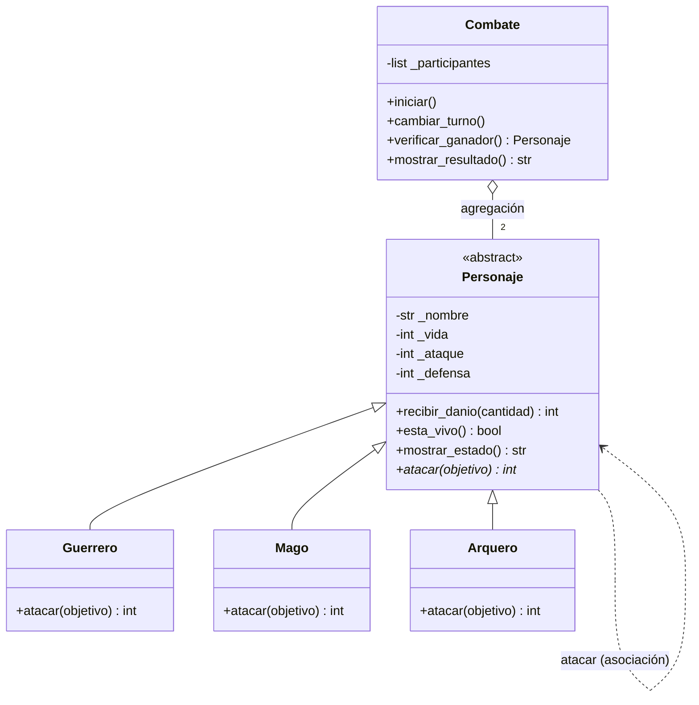

# Guardians of the Ancient Kingdom

Sistema de combate por turnos en Python con Programación Orientada a Objetos.

## 1. Descripción

En el reino de Eldoria existen tres órdenes de guardianes: Guerreros, Magos y Arqueros. Todos tienen nombre, vida, ataque y defensa, pero cada uno ataca distinto. El programa enfrenta a dos guardianes por turnos, calcula el daño, actualiza su vida y determina quién gana (o si hay empate).

## 2. Estructura

```text
Guardians-of-the-Ancient-Kingdom/
├── personajes.py        # Clases del sistema (no ejecuta nada al importarse)
├── main.py              # Creación de objetos, combates y casos de prueba
├── test_personajes.py   # Pruebas automatizadas con Pytest
└── README.md            # Documentación
```

## 3. Clases

- **`Personaje`** (abstracta): guarda y valida nombre, vida, ataque y defensa; ofrece `recibir_danio()`, `esta_vivo()` y `mostrar_estado()`; declara `atacar()` como abstracto.
- **`Guerrero`**: ataque +20 % antes de restar la defensa.
- **`Mago`**: su daño es su ataque, ignora la defensa.
- **`Arquero`**: duplica el daño `ataque - defensa` si el ataque supera la defensa.
- **`Combate`**: controla turnos, muestra el estado, detecta ganador y empates. No calcula daño: solo pide a cada personaje que ataque.

## 4. Relaciones

- **Herencia:** `Guerrero`, `Mago` y `Arquero` *son* un `Personaje`; comparten atributos y validaciones.
- **Asociación:** al atacar, un personaje recibe a otro como parámetro y le llama `recibir_danio()`.
- **Agregación:** `Combate` *tiene* dos personajes creados fuera de él; siguen existiendo si el combate termina.

## 5. Conceptos de POO

- **Abstracción:** `Personaje` no se instancia; define qué debe hacer un guardián (`atacar`), no cómo.
- **Encapsulamiento:** atributos privados (`_vida`, …) con getters/setters que validan, por eso no hay vida negativa ni nombres vacíos.
- **Herencia:** las subclases reutilizan constructor, setters y métodos comunes.
- **Polimorfismo:** `Combate` llama `atacante.atacar(objetivo)` sin preguntar el tipo.

## 6. Lógica del combate

| Clase | Daño |
|---|---|
| Guerrero | `max(0, floor(ataque × 1.2) − defensa)` |
| Mago | `ataque` |
| Arquero | `(ataque − defensa) × 2` si `ataque > defensa`; si no, `0` |

`recibir_danio()` no vuelve a restar la defensa, nunca baja la vida de 0 y devuelve el daño efectivo.

**Turnos:** ataca un participante, se muestra el estado, se verifica ganador y `cambiar_turno()` alterna. Dos ataques forman una ronda. Una ronda sin daño es **empate técnico**; 50 rondas sin ganador es **empate**; si una vida llega a 0, gana el otro.

## 7. Ejecución

```bash
git clone https://github.com/andresfreite4495-cloud/Guardians-of-the-Ancient-Kingdom.git
cd Guardians-of-the-Ancient-Kingdom
python main.py
```

Requiere Python 3.8 o superior.

## 8. Pruebas

`python main.py` comprueba los 12 casos obligatorios: creación de los tres tipos, vida inválida, nombres vacíos, ataque/defensa inválidos, habilidades de cada clase, vida nunca negativa, derrotado que no ataca, combate completo (Arthas vs Gandalf: gana Gandalf con 2 de vida, como en el enunciado) y empate técnico.

### Pytest (Reto 2)

Pytest ejecuta funciones `test_*` y reporta cuáles pasan o fallan, para verificar las reglas de forma repetible. Para correrlo:

```bash
pip install pytest
python -m pytest -v
```

Resultado:

```text
test_personajes.py::test_creacion_valida[Guerrero] PASSED                                                        [  3%]
test_personajes.py::test_creacion_valida[Mago] PASSED                                                            [  6%]
test_personajes.py::test_creacion_valida[Arquero] PASSED                                                         [  9%]
test_personajes.py::test_personaje_es_abstracto PASSED                                                           [ 12%]
test_personajes.py::test_vida_fuera_de_rango[101] PASSED                                                         [ 16%]
test_personajes.py::test_vida_fuera_de_rango[150] PASSED                                                         [ 19%]
test_personajes.py::test_vida_fuera_de_rango[-1] PASSED                                                          [ 22%]
test_personajes.py::test_vida_fuera_de_rango[-50] PASSED                                                         [ 25%]
test_personajes.py::test_nombre_vacio[] PASSED                                                                   [ 29%]
test_personajes.py::test_nombre_vacio[   ] PASSED                                                                [ 32%]
test_personajes.py::test_ataque_o_defensa_invalidos[0-5] PASSED                                                  [ 35%]
test_personajes.py::test_ataque_o_defensa_invalidos[-3-5] PASSED                                                 [ 38%]
test_personajes.py::test_ataque_o_defensa_invalidos[10--1] PASSED                                                [ 41%]
test_personajes.py::test_tipos_invalidos PASSED                                                                  [ 45%]
test_personajes.py::test_setters_validan PASSED                                                                  [ 48%]
test_personajes.py::test_dano_guerrero PASSED                                                                    [ 51%]
test_personajes.py::test_dano_guerrero_redondea_hacia_abajo_y_no_negativo PASSED                                 [ 54%]
test_personajes.py::test_dano_mago_ignora_defensa PASSED                                                         [ 58%]
test_personajes.py::test_dano_arquero_critico PASSED                                                             [ 61%]
test_personajes.py::test_arquero_sin_dano_si_no_supera_defensa PASSED                                            [ 64%]
test_personajes.py::test_vida_nunca_negativa PASSED                                                              [ 67%]
test_personajes.py::test_recibir_danio_no_aplica_defensa_de_nuevo PASSED                                         [ 70%]
test_personajes.py::test_danio_negativo_rechazado PASSED                                                         [ 74%]
test_personajes.py::test_derrotado_no_puede_atacar PASSED                                                        [ 77%]
test_personajes.py::test_no_se_puede_atacar_a_un_derrotado PASSED                                                [ 80%]
test_personajes.py::test_objetivo_invalido PASSED                                                                [ 83%]
test_personajes.py::test_combate_ejemplo_del_enunciado PASSED                                                    [ 87%]
test_personajes.py::test_empate_tecnico PASSED                                                                   [ 90%]
test_personajes.py::test_empate_por_limite_de_rondas PASSED                                                      [ 93%]
test_personajes.py::test_combate_valida_participantes PASSED                                                     [ 96%]
test_personajes.py::test_combate_no_se_ejecuta_dos_veces PASSED                                                  [100%]

================================================= 31 passed in 0.16s ==================================================
```

## 9. Reto 1 — Diagrama UML



Un diagrama UML de clases muestra clases, atributos, métodos y relaciones. Aquí, la flecha con triángulo vacío es **herencia**, la línea punteada es la **asociación** al atacar y el rombo vacío es la **agregación** de `Combate`. `Personaje` está marcada `<<abstract>>` y `atacar()*` es su método abstracto.

## 10. Reto 3 — Reto de abstracción

**¿Por qué `atacar()` es abstracto pero `recibir_danio()` está implementado en la base?**

`Personaje` se encarga de lo que es igual para todo guardián, y recibir daño lo es: validar que no sea negativo, restar sin bajar de 0 y devolver el daño efectivo. Escribirlo una vez en la base evita repetir código y garantiza que ninguna subclase se salte la validación (herencia y encapsulamiento).

Atacar, en cambio, es lo que diferencia a cada orden: el Guerrero usa `floor(ataque × 1.2) − defensa`, el Mago usa `ataque` y el Arquero duplica `ataque − defensa`. Una implementación común sería incorrecta para dos de las tres clases, así que `Personaje` solo declara el contrato con `@abstractmethod` y obliga a cada hija a definir el suyo (abstracción).

Así se logra el polimorfismo: `Combate` solo conoce `atacar()` y `recibir_danio()`, y enfrenta a cualquier pareja sin `if` por tipo. Si se agrega un `Paladin`, basta con heredar de `Personaje` e implementar `atacar()`.
