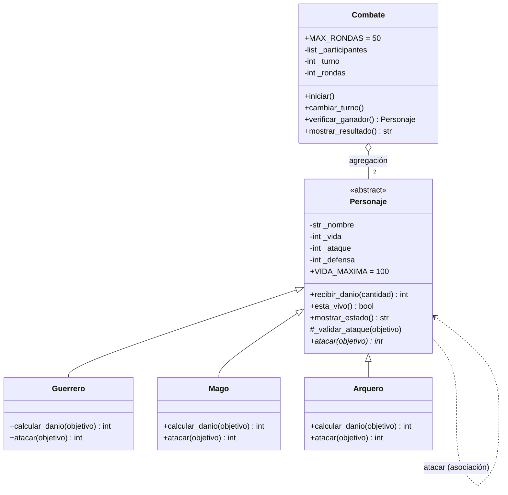

# Guardians of the Ancient Kingdom

Sistema de combate por turnos en Python, desarrollado con Programación Orientada a Objetos.

## 1. Descripción

En el reino de Eldoria existen tres órdenes de guardianes: Guerreros, Magos y Arqueros. Todos tienen nombre, vida, ataque y defensa, pero cada orden ataca de forma distinta. El programa enfrenta a dos guardianes por turnos, calcula el daño según las reglas de cada uno, actualiza su vida y determina automáticamente quién gana (o si hay empate).

## 2. Estructura

```text
Guardians-of-the-Ancient-Kingdom/
├── personajes.py        # Definición de las clases (no ejecuta nada al importarse)
├── main.py              # Creación de objetos, combates y casos de prueba visibles
├── test_personajes.py   # Pruebas automatizadas con Pytest (Reto 2)
└── README.md            # Documentación
```

- `personajes.py`: contiene `Personaje` (abstracta), `Guerrero`, `Mago`, `Arquero`, `Combate` y la excepción `AtaqueInvalidoError`.
- `main.py`: importa las clases, crea personajes, ejecuta ataques y combates y muestra los 12 casos de prueba obligatorios con su resultado.
- `test_personajes.py`: repite las reglas del sistema como pruebas automáticas que dicen por sí solas si pasan o fallan.

## 3. Clases

- **`Personaje`** (abstracta): guarda y valida los datos comunes (nombre, vida, ataque, defensa) y ofrece los comportamientos compartidos: `recibir_danio()`, `esta_vivo()`, `mostrar_estado()` y las validaciones previas a un ataque. Declara `atacar()` como método abstracto.
- **`Guerrero`**: su *Golpe poderoso* aumenta el ataque un 20 % antes de restar la defensa del objetivo (redondeo hacia abajo, mínimo 0).
- **`Mago`**: su *Hechizo penetrante* causa un daño igual a su ataque, ignorando la defensa.
- **`Arquero`**: su *Disparo crítico* duplica el daño convencional (`ataque - defensa`) cuando el ataque supera la defensa; si no la supera, el daño es 0.
- **`Combate`**: controla los turnos, muestra el estado después de cada ataque, detecta al ganador y decide los empates. No hace ningún cálculo de daño: solo le pide a cada personaje que ataque.

## 4. Relaciones entre clases

- **Herencia** (`Guerrero`, `Mago` y `Arquero` *son* un `Personaje`): evita repetir atributos y validaciones, y permite tratar a los tres como el mismo tipo.
- **Asociación** (un personaje ataca a otro): el atacante recibe al objetivo como parámetro de `atacar()` y le llama `recibir_danio()`. Los objetos colaboran sin que uno pertenezca al otro.
- **Agregación** (`Combate` *tiene* dos personajes): los personajes se crean fuera de `Combate` y se le entregan ya hechos. Si el combate desaparece, los personajes siguen existiendo y pueden participar en otro.

## 5. Conceptos de POO en el programa

- **Abstracción:** `Personaje` no se puede instanciar; define *qué* debe hacer todo guardián (`atacar`) sin decir *cómo*.
- **Encapsulamiento:** los atributos son privados (`_vida`, `_ataque`, …) y solo se tocan mediante propiedades (getters/setters) que validan. Por eso es imposible tener vida negativa o un nombre vacío.
- **Herencia:** las tres subclases reutilizan constructor, setters, `recibir_danio()`, `esta_vivo()` y `mostrar_estado()`.
- **Polimorfismo:** `Combate` llama `atacante.atacar(objetivo)` sin preguntar el tipo; cada objeto responde con su propia fórmula.

## 6. Lógica del combate

**Daño**

| Clase | Fórmula |
|---|---|
| Guerrero | `max(0, floor(ataque × 1.2) − defensa)` (se calcula con enteros para evitar errores de decimales) |
| Mago | `ataque` |
| Arquero | `(ataque − defensa) × 2` si `ataque > defensa`; `0` en otro caso |

`recibir_danio()` recibe un daño ya calculado, no vuelve a restar la defensa, nunca baja la vida de 0 y devuelve el daño efectivo.

**Turnos**

1. El primer participante ataca; se muestra el estado de ambos.
2. Se verifica si hay ganador; si no, `cambiar_turno()` alterna al otro.
3. Cuando los dos atacaron, se cierra la ronda.
4. Si en una ronda completa no hubo daño → **empate técnico**.
5. Si se completan 50 rondas sin ganador → **empate**.
6. Si la vida de alguien llega a 0 → gana el otro.

## 7. Ejecución

```bash
git clone https://github.com/andresfreite4495-cloud/Guardians-of-the-Ancient-Kingdom.git
cd Guardians-of-the-Ancient-Kingdom
python main.py
```

Solo requiere Python 3.8 o superior. Para las pruebas automáticas:

```bash
pip install pytest
pytest -v
```

## 8. Pruebas

`python main.py` comprueba los 12 casos obligatorios: creación de los tres tipos, rechazo de vida fuera de rango, nombres vacíos y ataque/defensa inválidos, habilidades de cada clase, vida nunca negativa, imposibilidad de atacar derrotado, combate completo (Arthas vs Gandalf, gana Gandalf con 2 de vida, igual que el ejemplo del enunciado) y empate técnico.

### Pytest (Reto 2)

Pytest es una herramienta que descubre y ejecuta funciones `test_*`, y reporta cuáles pasan o fallan, de modo que las reglas del sistema se verifican de forma repetible en vez de revisar mensajes a ojo. Las pruebas cubren: creación válida, valores rechazados, daño de cada clase (incluyendo redondeo y crítico), vida nunca negativa, derrotado que no puede atacar y resultado de los combates (victoria, empate técnico y empate por 50 rondas).

Resultado de la ejecución de `pytest -v`:

```text
test_personajes.py::test_creacion_valida[Guerrero] PASSED                                                        [  3%]
test_personajes.py::test_creacion_valida[Mago] PASSED                                                            [  6%]
test_personajes.py::test_creacion_valida[Arquero] PASSED                                                         [  9%]
test_personajes.py::test_personaje_es_abstracto PASSED                                                           [ 12%]
test_personajes.py::test_vida_fuera_de_rango[101] PASSED                                                         [ 16%]
test_personajes.py::test_vida_fuera_de_rango[150] PASSED                                                         [ 19%]
test_personajes.py::test_vida_fuera_de_rango[-1] PASSED                                                          [ 22%]
test_personajes.py::test_vida_fuera_de_rango[-50] PASSED                                                         [ 25%]
test_personajes.py::test_nombre_vacio[] PASSED                                                                   [ 29%]
test_personajes.py::test_nombre_vacio[   ] PASSED                                                                [ 32%]
test_personajes.py::test_ataque_o_defensa_invalidos[0-5] PASSED                                                  [ 35%]
test_personajes.py::test_ataque_o_defensa_invalidos[-3-5] PASSED                                                 [ 38%]
test_personajes.py::test_ataque_o_defensa_invalidos[10--1] PASSED                                                [ 41%]
test_personajes.py::test_tipos_invalidos PASSED                                                                  [ 45%]
test_personajes.py::test_setters_validan PASSED                                                                  [ 48%]
test_personajes.py::test_dano_guerrero PASSED                                                                    [ 51%]
test_personajes.py::test_dano_guerrero_redondea_hacia_abajo_y_no_negativo PASSED                                 [ 54%]
test_personajes.py::test_dano_mago_ignora_defensa PASSED                                                         [ 58%]
test_personajes.py::test_dano_arquero_critico PASSED                                                             [ 61%]
test_personajes.py::test_arquero_sin_dano_si_no_supera_defensa PASSED                                            [ 64%]
test_personajes.py::test_vida_nunca_negativa PASSED                                                              [ 67%]
test_personajes.py::test_recibir_danio_no_aplica_defensa_de_nuevo PASSED                                         [ 70%]
test_personajes.py::test_danio_negativo_rechazado PASSED                                                         [ 74%]
test_personajes.py::test_derrotado_no_puede_atacar PASSED                                                        [ 77%]
test_personajes.py::test_no_se_puede_atacar_a_un_derrotado PASSED                                                [ 80%]
test_personajes.py::test_objetivo_invalido PASSED                                                                [ 83%]
test_personajes.py::test_combate_ejemplo_del_enunciado PASSED                                                    [ 87%]
test_personajes.py::test_empate_tecnico PASSED                                                                   [ 90%]
test_personajes.py::test_empate_por_limite_de_rondas PASSED                                                      [ 93%]
test_personajes.py::test_combate_valida_participantes PASSED                                                     [ 96%]
test_personajes.py::test_combate_no_se_ejecuta_dos_veces PASSED                                                  [100%]

================================================= 31 passed in 0.16s ==================================================
```

## 9. Reto 1 — Diagrama de clases UML



Un diagrama de clases UML muestra las clases, sus atributos y métodos y cómo se relacionan. Aquí: la flecha con triángulo vacío es **herencia**; la línea punteada de `Personaje` a sí misma es la **asociación** (un personaje usa a otro al atacar); el rombo vacío en `Combate` es la **agregación** (combate agrupa dos personajes que existen por separado). `Personaje` está marcada `<<abstract>>` y `atacar()*` es su método abstracto (el asterisco lo indica).

## 10. Reto 3 — Reto de abstracción

**¿Por qué `atacar()` es abstracto pero `recibir_danio()` está implementado en la clase base?**

`Personaje` es responsable de lo que es verdad para *cualquier* guardián: tener vida protegida, poder estar vivo o derrotado y poder recibir daño. Recibir daño es idéntico para todos: se valida que la cantidad no sea negativa, se resta sin bajar de 0 y se devuelve lo efectivamente recibido. Como la regla no cambia, escribirla una vez en la base y heredarla evita repetir código y garantiza que ningún tipo de personaje pueda saltarse la validación (herencia + encapsulamiento).

Atacar, en cambio, es *lo que diferencia* a las órdenes. El Guerrero calcula `floor(ataque × 1.2) − defensa`, el Mago usa `ataque` sin mirar la defensa y el Arquero duplica `ataque − defensa` si supera la defensa. No existe una implementación común razonable en la base: cualquiera que se escribiera ahí sería incorrecta para dos de las tres clases. Por eso `Personaje` solo declara el contrato (`atacar(objetivo)`) con `@abstractmethod`, lo que obliga a cada subclase a definir su propia versión y hace imposible crear un guardián que no sepa atacar (abstracción).

Esa combinación habilita el polimorfismo: `Combate` solo conoce el contrato `atacar()` y `recibir_danio()` de `Personaje`. Puede enfrentar a un Guerrero con un Mago, o a un Arquero con otro Arquero, sin ningún `if` por tipo. Y si mañana se agrega un `Paladin`, basta con heredar de `Personaje` e implementar `atacar()`: `recibir_danio()` y `Combate` funcionan sin modificarse.
